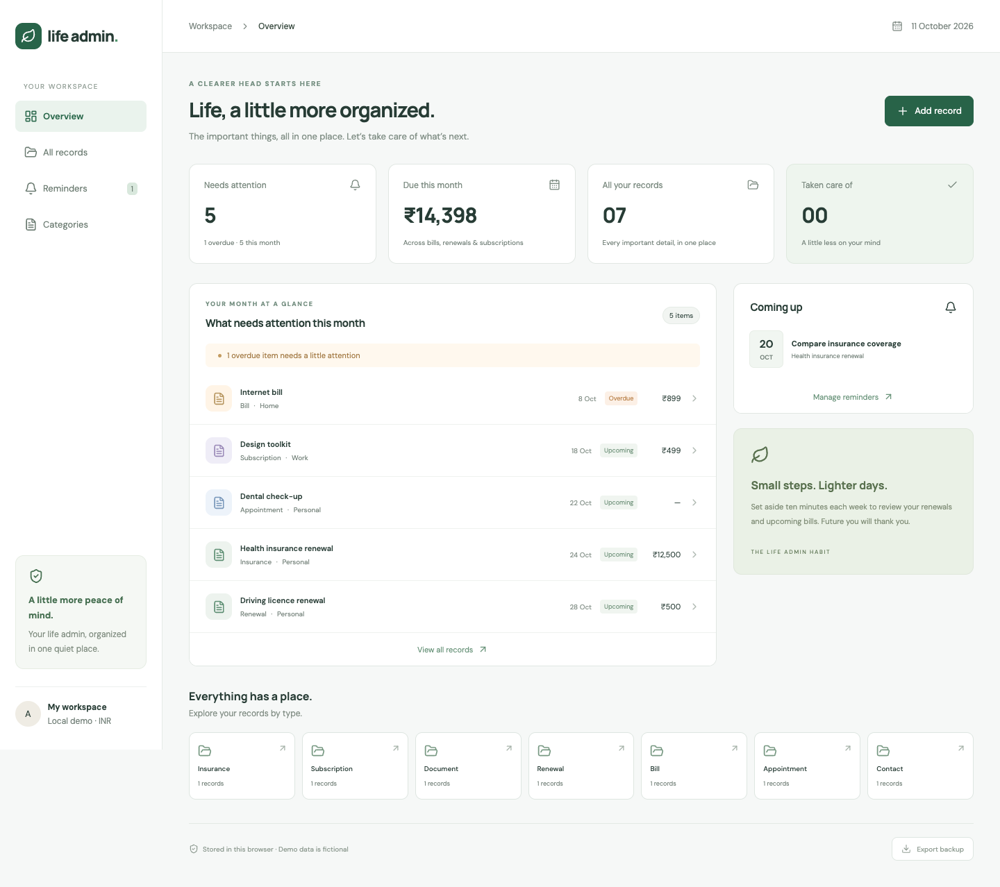

# Life Admin Dashboard

**A little less on your mind.** A small, polished personal dashboard for the bills, renewals, documents and appointments that are easy to lose track of.



## What it does

- **What needs attention this month:** unfinished records due through the end of the current local month, including older overdue items, sorted by date.
- Create, read, update and delete insurance, subscription, document, renewal, bill, appointment and contact records.
- Search by title, notes or category; filter by record type; mark items complete and reopen them.
- Add, rename and delete categories. Renaming updates associated records; nonempty categories cannot be deleted.
- Create, edit, complete and delete reminders linked to records.
- Upload, rename, download and delete attachments (PDF, PNG, JPEG and text; 5 MB each).
- Export a versioned JSON backup containing all records, categories, reminders and base64-encoded attachment bytes. The backup is unencrypted; keep it somewhere safe. Restore is planned next.
- Records, reminders and attachment blobs persist in IndexedDB across page reloads. Deleting a record also deletes its linked reminders and files.
- Responsive UI, labelled forms, input constraints and schema validation, with fictional demo data relative to the current month.

## Run locally

Requires Node.js 22.12+ (Node 24 LTS recommended).

```sh
npm ci
npm run dev
```

Open the local URL printed by Vite. No API keys, account setup or environment variables are needed.

```sh
npm test        # date boundaries, validation, cascade deletion, persistence
npm run build  # TypeScript check and production build
npm run test:e2e
```

Browser tests use Google Chrome; install Chrome locally, or run `npx playwright install chrome`. CI installs Chrome before running the tests. `npm run preview` serves the production build locally.

## Stack and structure

React + TypeScript, Vite, Zod, IndexedDB via `idb`, Lucide icons, Vitest and Playwright. Styling uses plain CSS so the layout is easy to inspect and customize.

```text
src/domain.ts       Data types, validation, date calculations, demo data
src/storage.ts      IndexedDB persistence
src/backup.ts       Versioned backup export with portable attachment bytes
src/App.tsx         Dashboard, record editor and management views
src/App.css         Responsive layouts and component styles
src/index.css       Typography and global styles
 tests/             Domain/storage tests and browser flows
 docs/              Screenshots, development plan and progress
```

The app saves a single snapshot transactionally. UI state updates only after the write succeeds, so a failed write does not pretend to have persisted data. This intentionally simple design suits a small single-user portfolio app; a larger version should use individual object stores and conflict-aware updates.

## Honest limitations

This is a **browser-local portfolio MVP**, not a production document vault or financial service. There is no backend, authentication, encryption, cross-device sync, email/push notification delivery, payment processing or automatic recurring billing. Reminders are visible only inside the app. Amounts use INR; contacts have a simple free-text detail field.

Data belongs to this browser and origin. Clearing site data removes it. Use fictional/demo information: backup export is available, while restore, migrations and multi-tab conflict handling are planned, not yet available. File checks are client-side convenience checks, not a malware scanner. Downloaded attachments are not rendered as HTML. Google Fonts is the only external UI resource; system fonts are used if it is unavailable.

## Seven-day development plan

See [the development plan](docs/DEVELOPMENT_PLAN.md) and [actual progress](docs/PROGRESS.md). Six daily work windows are opportunities for meaningful tasks, not a commit quota. All commits use real timestamps. Future milestones are explicitly separate from implemented features.

## Portfolio talking points

- Built a React and TypeScript dashboard that consolidates seven personal-administration record types with reusable validation and browser persistence.
- Implemented date-aware attention queues, linked reminders and Blob attachment storage, with cascading deletes and tested month/year boundaries.
- Added responsive layouts and automated domain, persistence and browser-flow checks.

No performance, adoption or impact metrics are claimed without measurement. Developed with AI assistance; review and understand the implementation before discussing it in interviews.

## License

MIT
