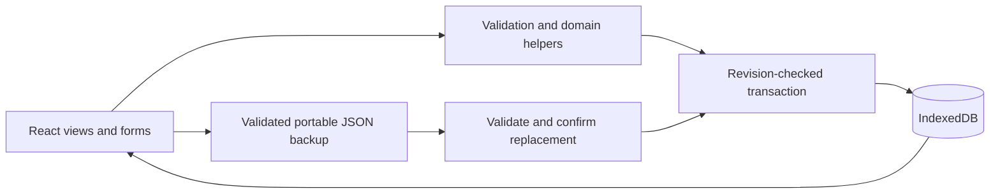

# Architecture

This is a browser-local, single-user React application. TypeScript describes the models; Zod validates editor inputs and portable backups. IndexedDB stores one workspace snapshot including Blob attachments. No server or account is required.

## Data and relationships

`Data` contains records, categories, reminders and files. Each record has one of seven types and a category. Reminders and files reference a record identifier. Record deletion cascades to its linked reminders/files. Nonempty categories cannot be deleted; renaming updates their records. Contact fields and recurrence are optional so older records remain readable.

`domain.ts` owns shared types, validation, demo data and attention selection. `recurrence.ts` owns completion and successor creation; `calendar.ts` owns date-only navigation. `storage.ts` owns persistence; `backup.ts` owns the portable format. React manages views and transient drafts. `App.tsx` remains intentionally compact in scope but is the first candidate for splitting as features grow.

## Persistence and concurrency

Local format version 1 metadata has an opaque revision. Initial opening seeds fictional data only for a genuinely empty workspace. Unversioned data is migrated in a transaction; unknown versions and malformed snapshots fail without reseeding. Every save compares its expected revision and writes data plus a new revision in the same transaction. The UI updates only after the commit succeeds.

A stale tab receives an error and keeps its draft. Reloading gets the saved workspace but discards unsaved drafts; automatic merging is not implemented. A same-tab guard prevents overlapping writes. All open tabs must run revision-aware code. The snapshot approach is simple for this small app; larger datasets should use separate stores and finer-grained updates.

## Backup boundary

The portable backup has its own version 1 format, independent of local metadata. Export and import validate shape and relationships. Files become base64 inside JSON, preserving bytes and metadata. Export checks encoded size before reading file contents and encodes sequentially. Restore confirms replacement before a revision-checked save. See [usage](USAGE.md) for exact limits. Backups are readable and unencrypted.

## Dates and recurrence

Due dates are date-only keys. Calendar arithmetic uses explicit UTC operations to avoid timezone shifts, while the current day comes from the user's local calendar. The attention queue includes unfinished records due through the current local month's end, including overdue records. Reminders remain a separate in-app list.

Monthly/yearly successors advance from the previous due date. Stored anchors preserve month-end and leap-day intent through short months. Reopening and recompleting cannot create a second successor. Files and reminders stay with the original record. There are no scheduled payments or external notifications.

## Validation evidence and boundaries

Vitest covers domain/date rules, storage migrations/transactions and backup bytes/limits. Playwright covers real Chrome interactions, keyboard focus, responsive views, downloads/restores and competing tabs. CI runs unit checks, a production build and the browser suite. Chrome coverage is not a cross-browser or full assistive-technology audit.

There is no authentication, encryption, backend or cross-device sync. Browser storage may be cleared or evicted. Use fictional information for portfolio demonstrations. Client-side MIME checks do not authenticate file contents or scan for malware.
